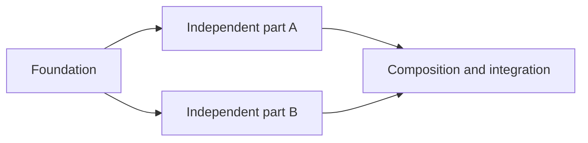

# Split Issue Into Subissues

Turn a broad issue into a reviewable dependency graph of bounded child issues. Separate planning from mutation: show the complete decomposition first and create or update issues only after explicit approval.

## Required workflow

### 1. Resolve and inspect the parent

- Resolve the exact issue tracker, repository or project, and parent issue.
- Verify that any local checkout belongs to the resolved parent before inspecting it. When the user supplies issue text without a repository, plan from the supplied evidence and mark repository context as unknown; never adopt an ambient checkout as the target.
- Read the complete parent title, body, attachments, labels, assignees, milestone, comments, and existing child links when available.
- Inspect linked designs, specifications, and repository context needed to understand existing implementation. Use read-only operations during this phase.
- Distinguish facts from assumptions. List missing destinations, content, ownership, or product decisions that could block a child issue.
- Do not create, edit, close, assign, label, or link issues yet.

### 2. Audit the current state

Summarize:

- Existing implementation or artifacts that can be reused
- Missing components, behavior, content, or infrastructure
- Generated, protected, or externally owned areas that constrain the work
- Unresolved decisions and external dependencies
- Relevant verification conventions such as tests, linting, type checks, builds, or manual QA

Keep this audit specific to the supplied task, but never encode repository-specific knowledge in this skill.

### 3. Design the decomposition

Create the smallest useful set of child issues. Each child must be:

- **Bounded:** one coherent outcome with clear in-scope and out-of-scope work
- **Independently implementable:** completable and reviewable without hidden work from another issue
- **Verifiable:** acceptance criteria state observable completion conditions
- **Mergeable:** avoid leaving the shared branch broken or introducing dead placeholders
- **Ownership-friendly:** minimize overlapping files and responsibilities where practical

Apply these heuristics:

- Extract shared prerequisites such as assets, schema, contracts, or infrastructure into a foundation issue when later work genuinely depends on them.
- Allow independent implementation issues to run in parallel after prerequisites are complete.
- Add a final composition or integration issue when separately built pieces must be assembled or validated together.
- Keep tests and verification with the behavior they validate; do not create a separate testing issue unless testing is itself a distinct deliverable.
- Avoid microscopic issues that only create a trivial helper, constant, or file with no independently reviewable outcome.
- Avoid duplicate scope and circular dependencies.
- Do not invent placeholder URLs, content, APIs, or product decisions to make an issue appear complete.

### 4. Present the complete proposal

Before any write operation, show all of the following.

#### Current-state audit

State what exists, what is reusable, what is missing, and what remains undecided.

#### Dependency diagram

Use a compact Mermaid flowchart when there is more than one child issue. Use provisional labels until real issue numbers exist. Example:



Ensure every diagram edge matches the dependency sections in the proposed issue bodies.

#### Summary table

For each proposed child, show its provisional ID, title, outcome, dependencies, and whether it can run in parallel.

#### Complete child issue drafts

Provide a title and full body for every proposed child. Adapt the headings to the task, but normally include:

```markdown
## Goal

State the independently valuable outcome.

## Context

Link or refer to the parent requirements and relevant artifacts.

## Implementation

List bounded work and important constraints. Include an expected structure only when it materially clarifies ownership.

## Acceptance criteria

- [ ] State observable, testable completion conditions.
- [ ] Include relevant accessibility, compatibility, migration, or failure behavior.
- [ ] Include proportionate verification.

## Out of scope

- Name adjacent work intentionally excluded from this issue.

## Dependencies

- Reference provisional child IDs or state `None`.

## Parent issue

Part of the parent issue.
```

Do not repeat the entire parent body in every child. Include enough context for a contributor to implement the child without reconstructing hidden assumptions.

#### Parent update preview

Show the section that will be added to or refreshed in the parent body. Include:

- Goal or decomposition summary
- Linked child checklist
- Dependency order
- Reusable implementation or context when useful
- Unresolved decisions

State explicitly that all unrelated existing parent content, including images, links, requirements, and notes, will be preserved.

#### Metadata plan

Show proposed labels, assignees, milestone, and native parent-child relationship behavior. Do not silently inherit metadata; include inheritance in the approval preview.

### 5. Require explicit approval

- Ask the user to approve the exact decomposition, child bodies, parent update, and metadata plan.
- Treat approval as valid only after the complete proposal has been shown.
- Do not treat the original request to split an issue as approval to create issues.
- If the user changes titles, scope, dependencies, bodies, or metadata, revise the proposal and request approval again.
- Tool permission prompts do not replace this conversational approval gate.

Stop after the proposal when approval has not been given.

### 6. Create only the approved issues

After approval:

1. Re-read the parent immediately before writing so updates are based on its latest body and metadata.
2. Create prerequisite child issues first.
3. Create independent children next; parallelize tool calls only when safe.
4. Create final integration children after real dependency issue numbers are known.
5. Replace provisional dependency references with real issue links or numbers.
6. Add a reciprocal parent reference to every child body.
7. Apply only the approved labels, assignees, and milestone.
8. Use the tracker's native parent/subissue relationship when available. Otherwise use linked task-list items in the parent plus reciprocal parent references in children.

If creation partially fails, keep successful issue numbers, retry only failed operations when safe, and never create duplicates to conceal an error.

### 7. Preserve and update the parent body

- Reuse the latest parent body fetched immediately before mutation.
- Preserve unrelated content verbatim, including attachments, images, original requirements, links, notes, and manually written checklists.
- Append the managed planning section on the first run.
- Delimit the managed section with these markers:

```markdown
<!-- subissue-plan:start -->
...managed decomposition section...
<!-- subissue-plan:end -->
```

- On later runs, replace only the content between those markers.
- Never replace the entire body with only the decomposition plan.
- If a similar unmarked section already exists, show how it will be reconciled and obtain approval before removing or rewriting it.
- Add linked checklist items for every created child and preserve the approved dependency order and unresolved decisions.

### 8. Verify and report

After writing:

- Re-fetch every created child and the parent.
- Verify titles, bodies, dependencies, metadata, parent references, and native relationships or checklist links.
- Confirm the parent's pre-existing content remains present.
- Confirm no duplicate children or duplicate managed sections were created.
- Report the parent URL and every child URL with its title.
- Report partial failures accurately and state what remains to be completed.

## Tool guidance

- Prefer the issue tracker's structured connector or API for reads and writes.
- Use local repository inspection only after verifying that the checkout belongs to the parent issue, and only for evidence needed to produce a better decomposition.
- Fall back to a CLI only when the connector lacks required child-linking or update capabilities.
- Never expose tokens or authentication details.
- Do not modify repository files unless the user separately asks for implementation work.

## Quality checks

Before presenting the proposal, confirm:

- Every parent requirement belongs to at least one child or is explicitly out of scope.
- Every dependency is necessary and points in one direction.
- Parallel issues do not claim the same primary outcome.
- Each child can be understood without private reasoning from the planning conversation.
- Acceptance criteria describe outcomes rather than implementation activity alone.
- The final integration issue does not duplicate implementation already assigned elsewhere.
- Unknown decisions are visible and not disguised as placeholders.

Before mutating issues, confirm:

- The user approved the latest complete proposal.
- The target parent and tracker are exact.
- The latest parent body has been fetched.
- The metadata and relationship plan match the approval.
